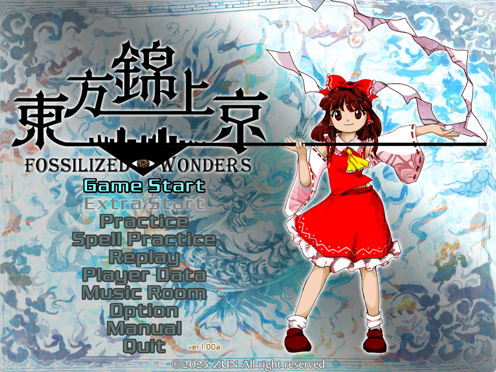
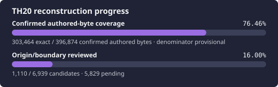

# 東方錦上京 ～ Fossilized Wonders.

Agent workflow: follow the highest-priority requirements in [AGENTS.md](AGENTS.md). Use affected exact checks and searchable Markdown knowledge; ordinary notes do not require full CI or replay.

<p align="center">
  
</p>

<p align="center">
  
</p>

Source reconstruction of the original Japanese TH20 v1.00a **Steamless**
executable. Function-level exactness requires reproducible comparison against
one hash-attested target. The workflow follows [TH095](https://github.com/N0zoM1z0/th095),
with Ghidra and a separate modern MSVC environment for TH20.

> [!IMPORTANT]
> Reconstruction is in progress. Verified source components and exact function
> comparisons are available; the repository does not yet build a playable game.
> Origin review, source presence, exactness, linkage and runtime behavior are
> separate statuses.

## Exact target

Supply your own executable as `resources/th20.exe`:

| Property | Required value |
| --- | --- |
| Version | Japanese 1.00a, user-selected Steamless variant |
| Embedded title/replay label | 1.00c; recorded separately from registry/package identification |
| Size | `1,858,560` bytes |
| SHA-256 | `a274b45fe6ec53511718bb328c2ff169a74e67f95d1b0c74d97d348b955a0897` |
| MD5 | `e7ccdbd2f319ba868ce386e484fff1d3` |
| Image base | `0x00400000` |
| Entry point | `0x005435E0` |

```bash
scripts/import-target.sh /path/to/th20.exe
scripts/repo-python scripts/verify-target.py
```

The Steam-original backup is retained locally as provenance evidence. Its
code differs from the comparison target. See [target provenance](docs/TARGET_PROVENANCE.md)
for official Japanese release and independent executable identification.
Game executables, assets, private databases, toolchains and reference checkouts
are excluded from Git.

## Repository status

The README SVG is generated from the canonical ledgers. Its percentage measures
exact coverage of the currently confirmed authored-byte set; origin review is
still incomplete. Read live counts with:

```bash
scripts/repo-python scripts/report-reconstruction-status.py --summary
```

A complete playable reconstruction has not been built, linked or runtime-validated.
Use the [current handoff](docs/RE_HANDOFF.md) for the next action, the
[open backlog](docs/RE_OPEN_BOSS_BACKLOG.md) for remaining large functions, and
[the evidence index](docs/EVIDENCE_INDEX.md) for individual proofs.

| Area | Current state |
| --- | --- |
| Player | The [3,111B main frame](docs/PLAYER_MAIN3111_STRICT_EXACT.md) and [555B movement](docs/PLAYER_MOVEMENT555_STRICT_EXACT.md) are strict exact. The complete [4,072B state-frame contribution](docs/PLAYER_STATE4043_NATIVE_FRONTIER.md) is source-present, NONEXACT; [thirteen physical dependencies](docs/PLAYER_STATE_NATIVE_ACCESSORS_STRICT_EXACT.md) replay exact. |
| Animation rendering | Many backends, geometry routines and the 3,180B quad-submit contribution are exact. The enclosing [5,993B Draw dispatcher](docs/ANIMATION_DRAW_BOSS_C2_DEBUG_TRACE.md#2026-11-27-current-parent-scorecard-after-first-result-local-recovery) remains NONEXACT at a 5,977B candidate with the native 0x204 frame; four register-source reloads remain open. |
| Glyph and text | The [2,245B compositor](docs/GLYPH_MASK_COMPOSITE2245_STRICT_EXACT.md), [2,316B GDI contribution](docs/GLYPH_TEXT_CORE2227_STRICT_EXACT.md) and queue support are exact. The 578B ASCII, 294B submit and 586B centered callers remain open. The [417B formatter uses narrow characters](docs/RENDERER_TEXT_NARROW_CRT_ABI.md). |
| Card | The [1,896B spell start](docs/CARD_START1896_STRICT_EXACT.md) and [602B finish](docs/CARD_FINISH_602_STRICT_EXACT.md) are exact; the larger battle controller remains open. |
| Large dispatchers | Bullet extended commands and Animation VM update have maintained source; the Enemy ECL root remains partial. All three parents are NONEXACT. See [the backlog](docs/RE_OPEN_BOSS_BACKLOG.md). |

Mapping, source presence, compilation, linkage, runtime behavior and exactness
are separate facts. Exact game-function credit is recorded in
[`config/matches.csv`](config/matches.csv); supporting compiler/library units
do not add authored credit.

## Build and verify

Documentation and artifact-cleanup handoffs use diff/link checks and protected
product hashes. An unchanged native compiler-input graph needs no replay,
compiler, Ghidra or full CI run. Source and ABI changes require comparison of
the actual affected include closure, including complete extents and relocations. Use the `gpt-6.1-sol:` commit prefix.

When code or infrastructure changes warrant broader checks, public CI needs
Python 3.11+, with no original game or C++ compiler:

```bash
scripts/repo-python scripts/ci.py --full
```

Public CI checks syntax, private-artifact exclusion, source profiles, ledgers,
build configuration and synthetic exact-oracle cases. It runs without the game,
compiler, Ghidra or optional Python packages. The historical
portable C++ semantic suite has been retired; [retained tests](tests/README.md)
cover exact comparison and repository tools. Exact checkpoints require affected
native builds and complete strict replay. A specific unresolved behavior or ABI
question can use a temporary probe under `.analysis/`.

Private preflight for reconstruction changes is:

```bash
git status --short --branch
scripts/repo-python scripts/verify-target.py
scripts/repo-python scripts/report-reconstruction-status.py --summary
scripts/repo-python scripts/validate-tracking.py --require-target
```

On a fresh private workspace, provision tools as described in
[Tools](docs/TOOLS.md), then run `scripts/repo-python scripts/ghidra.py import` once.
Every query re-attests the executable and complete mapped code section;
inventory refreshes never overwrite reviewed ledgers.
For source changes, derive the actual affected providers from captured include
closures and manifest dependencies. Build and replay only those units, with
individual unit commands or explicit `--source` filters. New exact acceptance
requires affected cold builds; see [build and matching](docs/BUILD_MATCHING.md).

## Reference review

[Oracatt/Touhou20](https://github.com/Oracatt/Touhou20) is pinned locally under
ignored `_reference/Touhou20`. Its target hash matches ours. Its v1.00c label
comes from embedded strings; our v1.00a identification follows the independent
hash registry and supplied package. Both observations are preserved in provenance.

The [review](docs/REFERENCE_REVIEW.md) records the repository-wide evidence audit,
module dispositions, stale reports and independently verified absorption.
Validated source diagnostics route further analysis; reference source, build
layout and completion claims are not imported wholesale.

The [function-by-function review](docs/REFERENCE_FUNCTION_REVIEW.md) is complete
for all 6,945 indexed implementations, including one parser omission recovered
during manual review. All 113 parser-gap files are manually reconciled. The
[final audit](docs/REFERENCE_SUPPORT_REVIEW.md) records coverage and evidence
limits; nonexact implementations remain documented for further reconstruction.

## Documentation

- [Current handoff](docs/RE_HANDOFF.md)
- [Focused evidence index](docs/EVIDENCE_INDEX.md)
- [Architecture and target inventory](docs/ARCHITECTURE.md)
- [Reconstruction workflow](docs/RE_WORKFLOW.md)
- [Independent oracles](docs/ORACLES.md)
- [Build and strict matching](docs/BUILD_MATCHING.md)
- [Ghidra setup and attestation](docs/GHIDRA.md)
- [Tool routing](docs/TOOLS.md)
- [Source ownership](docs/SOURCE_MAP.md)
- [Semantic reconstruction policy](docs/SEMANTIC_RECONSTRUCTION.md)
- [Reference review](docs/REFERENCE_REVIEW.md)
- [Function-by-function reference review](docs/REFERENCE_FUNCTION_REVIEW.md)
- [Complete reference review and final tooling batch](docs/REFERENCE_SUPPORT_REVIEW.md)
- [Enemy movement, spawn and variable review](docs/REFERENCE_ENEMY_MOVEMENT_REVIEW.md)
- [Runtime invincibility launcher](docs/RUNTIME_PATCH.md)
- [Verified knowledge base](docs/KNOWLEDGE_BASE.md)
- [Roadmap](docs/ROADMAP.md)
- [Progress commands](docs/PROGRESS.md)
- [Agent rules](AGENTS.md)

## Credits

- [Oracatt/Touhou20](https://github.com/Oracatt/Touhou20): reference
  reconstruction, source diagnostics and behavioral investigations that guide
  our independent, function-by-function review.
- [N0zoM1z0/th095](https://github.com/N0zoM1z0/th095): reconstruction workflow,
  exact-oracle control plane, tracking conventions and README/progress layout.

## License

[MIT](LICENSE) for this repository's original code and TH095-derived control
plane. It grants no rights to the original game, downloaded tools or external
reference material. Maintained prose and commit messages are in English;
official names and original target evidence retain their original language.
