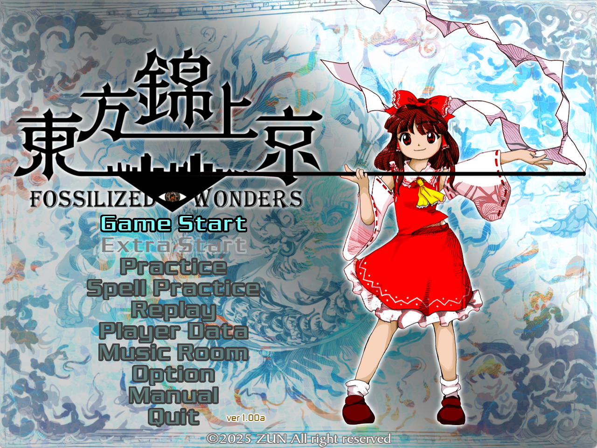
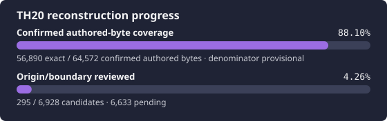

# 東方錦上京 ～ Fossilized Wonders.

<p align="center">
  
</p>

<p align="center">
  
</p>

Source reconstruction of the original Japanese TH20 v1.00a **Steamless**
executable. Function-level exactness requires reproducible comparison against
one hash-attested target. The workflow follows [TH095](https://github.com/N0zoM1z0/th095),
with Ghidra and a separate modern MSVC environment for TH20.

> [!IMPORTANT]
> Reconstruction is in progress. Verified source components and exact function
> comparisons are available; the repository does not yet build a playable game.
> Origin review, source presence, exactness, linkage and runtime behavior are
> separate statuses.

## Exact target

Supply your own executable as `resources/th20.exe`:

| Property | Required value |
| --- | --- |
| Version | Japanese 1.00a, user-selected Steamless variant |
| Embedded title/replay label | 1.00c; recorded separately from registry/package identification |
| Size | `1,858,560` bytes |
| SHA-256 | `a274b45fe6ec53511718bb328c2ff169a74e67f95d1b0c74d97d348b955a0897` |
| MD5 | `e7ccdbd2f319ba868ce386e484fff1d3` |
| Image base | `0x00400000` |
| Entry point | `0x005435E0` |

```bash
scripts/import-target.sh /path/to/th20.exe
scripts/repo-python scripts/verify-target.py
```

The Steam-original backup is retained locally as provenance evidence. Its
code differs from the comparison target. See [target provenance](docs/TARGET_PROVENANCE.md)
for official Japanese release and independent executable identification.
Game executables, assets, private databases, toolchains and reference checkouts
are excluded from Git.

## Repository status

At the October 30, 2026 checkpoint the maintained graph has **1,283
source-present mappings**, **1,282 strict canonical native units** and
**297 canonical MSVC object/receipt providers**. Independently verified
game-authored whole-function exactness is **633 complete functions /
233,199 original native bytes**. These are dated values, not a
whole-game buildability or playable-game claim: always run
`scripts/repo-python scripts/report-reconstruction-status.py --summary`
for the live inventory and consult the
[current concise handoff](docs/RE_HANDOFF.md) for the unfinished bosses.

| Area | Verified current state |
| --- | --- |
| Large game-original exact bodies | [11,110B ECL Runtime tick](docs/EXACT_ECL_TICK_RECONSTRUCTION.md), [3,735B Bullet emitter /3,832B complete compiler extent](docs/BULLET_EMITTER_3735_3832_STRICT_EXACT_RECONSTRUCTION.md), [3,490B InputDevice poll](docs/INPUT_DEVICE_POLL_3490_EXACT_RECONSTRUCTION.md), [456B Animation handle resolver](docs/ANIMATION_POOL_RESOLVER_456_STRICT_EXACT_RECONSTRUCTION.md), [1,404B Bullet command-11](docs/BULLET_COMMAND11_1404_EXACT_RECONSTRUCTION.md), [1,036B LZSS compressor](docs/ARCHIVE_LZSS_COMPRESS_1036_EXACT_RECONSTRUCTION.md) and [73B Animation factory](docs/ANIMATION_FACTORY_73_CLASS_TAG_STRICT_EXACT_RECONSTRUCTION.md) are **whole native strict exact**. |
| Animation closed five-vertex line-strip Boss | [Whole original 2,169B/533-x86 game line-strip renderer, 2,169/2,169B whole strict native exact](docs/ANIMATION_SHAPE_LINESTRIP_2169_STRICT_EXACT.md), real typed 5×20B vertices and native D3D9 `LINESTRIP=3` (not triangle fan). All 12 E8 and 17 HIGHLOW original site/destinations attested, no duplicate 78B callee/1,980B sibling or 5,993B main Draw parent credit. |
| Polygon Motion group Boss and native container helper pair | [Whole original 233B/78-i386 group Boss strict exact plus whole 23B/19B array pointer helpers](docs/ANIMATION_POLYGON_MOTION_GROUP_233_23_19_STRICT_EXACT.md): real 3×`0x3D4` item layout, nine original E8/two HIGHLOW site/targets and 3/3 scoped canonical units. Container helpers' original authorship unresolved, excluded from authored count; 104B outline child still NONEXACT. |
| Motion polygon wrapper pair | [76B original game filled TRIANGLEFAN caller whole strict exact; adjacent 104B polygon-outline caller semantic source NONEXACT](docs/ANIMATION_POLYGON_MOTION_CALLERS_76_104_FRONTIER.md). True Motion/Vector3 subobjects, 455B/1,204B exact rendering children, original 233B upstream caller; 104B ESI lifetime not faked. |
| Animation polygon outline TRIANGLESTRIP Boss | [Whole original 1,204B/354-x86 game polygon stroke renderer 1,204/1,204 native strict exact](docs/ANIMATION_POLYGON_OUTLINE_1204_STRICT_EXACT.md), original 20 E8/8 HIGHLOW physical source roles, first/last/closed polygon joins and authentic count-only persistent cursor advance despite 2×count generated vertices. No parent/leaf duplicate credit. |
| Vector2 value-return compound leaf pair | [Whole original 72B multiply-assign and 77B add-assign strict native exact](docs/ANIMATION_VECTOR2_COMPOUND_VALUE_72_77_STRICT_EXACT.md): both mutate `Vector2` but return by VALUE, using the original hidden result pointer/`ret 8`; real direct callers from unfinished 1,204B polygon stroke Boss; 149 authored original native bytes credited once. |
| Animation exact corner anchor data and rotated-corner Boss frontier | [Original 96B quad anchor `.rdata` now true source-defined and exactly identical; 1,486B rotated projection whole semantic source remains NONEXACT](docs/ANIMATION_CORNER_AXIS_96_ROTATED_1486_FRONTIER.md). The original real `Angle` post-constructor NOP at +0x41 is absent from natural 1,485B candidate despite matching all 13 call/9 data roles; no forged strict unit or code byte credit. |
| Animation four-corner projection Boss | [Whole original 985B/233-x86 genuine 2×3×4 corner geometry and strict 985/985 native bytes](docs/ANIMATION_CORNER_PROJECTION_985_VERTEX_DRAW_455_STRICT_EXACT.md), original six E8/13 PE HIGHLOW roles and original 96B fixed mode-indexed table; enclosing game Draw parent remains NONEXACT. |
| Animation colored-vertex fan and line methods | [Two independent whole original 455B/129-i386 TRIANGLEFAN and LINESTRIP strict exact functions](docs/ANIMATION_CORNER_PROJECTION_985_VERTEX_DRAW_455_STRICT_EXACT.md), original 4 E8/3 PE HIGHLOW roles each, true count thresholds and D3D9 type6 versus type3. |
| Animation single-vertex POINTLIST renderer | [Whole original 375B/100-i386 game POINTLIST strict native exact](docs/ANIMATION_SHAPE_FINAL_THREE_375_809_583_STRICT_EXACT.md), typed fixed-pool vertex[0], 5 actual E8/4 PE HIGHLOW site/targets and complete 375/375 bytes. |
| Animation alternating TRIANGLEFAN renderer | [Whole original 809B/214-i386 game fan strict exact](docs/ANIMATION_SHAPE_FINAL_THREE_375_809_583_STRICT_EXACT.md), genuine center, signed i%2 alternating radius, 8 E8/8 HIGHLOW and full 809/809 native bytes. |
| Animation alternating LINESTRIP renderer | [Whole original 583B/160-i386 game line strict exact](docs/ANIMATION_SHAPE_FINAL_THREE_375_809_583_STRICT_EXACT.md), real signed radius alternation and D3D9 type3, 6 E8/5 HIGHLOW and full 583/583 strict native bytes. Enclosing 5,993B Draw still NONEXACT. |
| Animation elliptic LINESTRIP Boss | [Whole original 660B/178-i386 ellipse outline, strict native 660/660 exact](docs/ANIMATION_SHAPE_ELLIPTIC_660_863_STRICT_EXACT.md), all 12 authentic original E8 and eight PE HIGHLOW site/target pairs, real Vector3/XY rotation and D3D9 LINESTRIP type3. Main 5,993B Draw remains NONEXACT. |
| Animation elliptic TRIANGLEFAN Boss | [Whole original 863B/226-i386 ellipse center/perimeter, strict native 863/863 exact](docs/ANIMATION_SHAPE_ELLIPTIC_660_863_STRICT_EXACT.md), all 12 original E8 and nine PE HIGHLOW fields/true targets, native Vector3 constructor ordering and D3D9 TRIANGLEFAN type6. No parent-code duplicate credit. |
| Animation alternating-radius TRIANGLESTRIP Boss | [Whole original 899B/236-x86 game alternating signed-parity polar ring, 899/899 strict native bytes](docs/ANIMATION_SHAPE_ALTERNATING_899_STRICT_EXACT.md). Native 4 precomputed radius source values, two genuine signed `i%2` checks, all 7 E8/10 PE HIGHLOW site/targets exact; the larger 5,993B Draw parent remains NONEXACT. |
| Animation rotated two-radius TRIANGLESTRIP Boss | [Whole original 1,001B/258-x86 dual-ellipse ring, 1,001/1,001 native strict exact](docs/ANIMATION_SHAPE_ROTATEDRING_1001_TWOPOINT_1116_STRICT_EXACT.md). 15 original physical E8 +13 native PE HIGHLOW field/target roles, authentic Vector3/cos/sin/rotation and real D3D9 type5. Enclosing 5,993B Draw still NONEXACT. |
| Animation two-endpoint LINESTRIP Boss | [Whole original 1,116B/282-x86 game shape, 1,116/1,116 strict native exact](docs/ANIMATION_SHAPE_ROTATEDRING_1001_TWOPOINT_1116_STRICT_EXACT.md). Ten real E8/13 PE HIGHLOW sites/targets and true five reciprocal-W writes despite only two vertices, original type3 LINESTRIP. |
| Animation circular LINESTRIP + dual-radius TRIANGLESTRIP Bosses | [Whole original 541B/147-i386 and 766B/201-i386 polar source Bosses, both strict exact](docs/ANIMATION_SHAPE_POLAR_LINES_541_766_STRICT_EXACT.md), original typed 20B vertex pool, genuine 6 E8 +5 HIGHLOW and 7 E8 +8 HIGHLOW respectively, full **541/541 +766/766 native strict code**. D3D9 LINESTRIP type3 versus two-sided TRIANGLESTRIP type5; 5,993B main Draw still NONEXACT. |
| Animation rounded LINESTRIP Boss | [Entire original 971B/255-x86 rounded outline renderer, 971/971 strict original native bytes](docs/ANIMATION_SHAPE_ROUNDEDLINE_971_STRICT_EXACT.md), true no-center quarter perimeter, D3D9 LINESTRIP type3, nine E8 and 18 original PE HIGHLOW real site/target pairs. Main 5,993B Draw still NONEXACT. |
| Animation simple TRIANGLEFAN Boss | [Entire original 755B/197-x86 simple center+perimeter renderer, 755/755 native strict exact](docs/ANIMATION_SHAPE_SIMPLEFAN_755_STRICT_EXACT.md), genuine input-angle parameter reused as step, D3D9 TRIANGLEFAN type6 and all eight original E8/eight PE HIGHLOW site/target roles. Distinct from larger rounded fan and nonexact main Draw. |
| Animation rounded TRIANGLEFAN Boss | [Whole original 1,174B/303-x86 center and perimeter fan, 1,174/1,174 native strict exact](docs/ANIMATION_SHAPE_ROUNDEDFAN_1174_STRICT_EXACT.md), all nine native E8 and 19 PE HIGHLOW physical roles, 65,536×20B original pool and actual D3D9 type6; original Draw main still NONEXACT. |
| Animation outlined-rectangle leaf | [Whole 240B/76-native original two-pass outline wrapper strictly exact](docs/ANIMATION_SHAPE_OUTLINE_240_STRICT_EXACT.md), authentic half-alpha and +1 margin first pass, two physical E8 to already-exact 1,980B rectangle; no duplicated game bytes. |
| Animation three-vertex Triangle Boss | [Entire 1,601B/394-i386 original game triangle renderer and whole 1,601/1,601 native strict exact](docs/ANIMATION_SHAPE_TRIANGLE_1601_STRICT_EXACT.md). Original 3-float X/Y anchored geometry and true 3.0f/2.0f proportion, three exact 78B XY calls; 11 genuine native E8 and 19 PE HIGHLOW site/target pairs exact, D3D9 TRIANGLESTRIP type5. Original main 5,993B Draw remains NONEXACT. |
| Animation four-vertex rectangle Boss | [Entire original 1,980B/486-i386 shape rectangle renderer and 1,980/1,980 whole strict exact native proof](docs/ANIMATION_SHAPE_RECT_1980_STRICT_EXACT.md), authentic signed 4-float anchor arrays, real 65,536×20B sprite pool guard, all 12 physical E8 and 16 PE HIGHLOW targets independently attested. Original 5,993B enclosing Draw dispatcher remains NONEXACT. |
| Animation game shape XY transform leaf | [Original 78B/20-i386 custom Vector2 cdecl rotate-translate, entire 78/78B native strict exact](docs/ANIMATION_SHAPE_XY78_STRICT_EXACT.md). Original independently authenticates 11 direct E8 game callers across three large geometry Bosses; no original PE relocations and no parent code credit. |
| Animation polygon ring/strip Boss | [Whole 1,468B/387-i386 original game shape-ring generator, 1,468/1,468B strict exact](docs/ANIMATION_SHAPE_RING_1468_STRICT_EXACT.md). Genuine 65,536 ×20B original vertex pool, one real inner/outer cursor, ring angle/width calculation, full 11 E8 and 26 native PE HIGHLOW positions/targets. The corrected real int-return receiver ABI retains ten formerly exact affected units under scoped replay; enclosing 5,993B Animation Draw Boss remains NONEXACT. |
| Animation strip9 entire renderer | [Whole original 612B/182-x86 game strip9 draw strict native exact](docs/ANIMATION_DRAW_STRIP_MODE9_612_STRICT_EXACT.md), real 28B vertex stride, D3D FVF/texture-state cache and original `Animation+0x4A0` two-bit mode, 11 exact native E8 and five genuine Graphics PE HIGHLOW roles, 612/612B complete original. Main 5,993B enclosing Draw Boss remains NONEXACT. |
| Animation strip11 entire renderer | [Whole original 534B/159-x86 game strip11 draw strict native exact](docs/ANIMATION_DRAW_STRIP_MODE11_534_STRICT_EXACT.md), real seven-float/28B vertex stride and renderer texture/FVF pipeline, all ten original direct E8 and six Graphics HIGHLOW roles full original site/target exact; one source exact 534/534B. Enclosing 5,993B Draw dispatcher remains NONEXACT. |
| Animation Mode8 six-order complete renderer Boss | [Whole original 4,347B/1,063 native x86 Mode8 Animation renderer and genuine six-case code-pointer table](docs/ANIMATION_DRAW_MODE8_4347_STRICT_EXACT.md), **4,372/4,372 strict relocated bytes** including genuine 1B NOP and six original direct 32-bit PE case pointers. All **101 real E8 and 45 HIGHLOW physical fields/targets exact**, natural MSVC typed C++ source. Its enclosing 5,993B main Draw dispatcher remains NONEXACT. |
| Graphics depth-write enable leaf | [Whole original 92B native D3D9 Z-write game state transition strict exact](docs/GRAPHICS_DEPTH_WRITE_ENABLE_92_STRICT_EXACT.md), true `Graphics+DBC` state=1, original AnimationPool flush and D3D9 SetRenderState(14,1), 92/92B native relocated bytes, independent new leaf credited separately from the exact 2,136B Mesh caller. |
| Animation mode24/25 complete mesh render Boss | [Whole original 2,136B/504-x86 mesh/texture renderer with 32 native E8 and 20 PE HIGHLOW, 2,136/2,136B strict exact](docs/ANIMATION_DRAW_MESH2425_2136_STRICT_EXACT.md). All original D3DX/Graphics device/texture calls preserved; original matrix/view folded aliases do not duplicate game byte credit. Its 5,993B enclosing Draw Boss remains NONEXACT. |
| Animation Mode6 complete render Boss | [Entire original 2,769B/683-x86 game renderer plus genuine five-pointer case table, 2,792/2,792 strict exact](docs/ANIMATION_DRAW_MODE6_2769_STRICT_EXACT.md). Independently verified all 28 original E8, 78 in-body HIGHLOW and five post-RET case pointers. Native fog-first COMISS/NaN handling, exact `0x64` frame and real game RGBA channel math, one newly credited full game function. The enclosing 5,993B Draw dispatcher remains NONEXACT. |
| Animation Mode6 complete screen-projection Boss | [Original 1,378B/335 x86 screen projection and four real projected XY corners](docs/ANIMATION_DRAW_MODE6_SETUP_1378_STRICT_EXACT.md), full **1,378/1,378B strict exact** with 17 original E8, 21 PE HIGHLOW and independently proven 2×3×4 screen offset tensor. Its larger 2,769B Mode6 caller is now independently whole strict exact; only the 5,993B enclosing Draw dispatcher remains NONEXACT. |
| Animation mode6 projection math leaves | [73B Vector3 magnitude +86B renderer XY rotation and translation](docs/ANIMATION_PROJECTION_MATH_73_86_STRICT_EXACT.md), both complete original strict native exact **159/159B**, independently identified five genuine original 1,378B Mode6 setup E8 sites. The parent remains NONEXACT. |
| Animation mode7 setup / matrix Boss | [Original complete 1,996B Animation matrix, rotations and four-corner setup strict exact](docs/ANIMATION_DRAW_MODE7_SETUP_1996_STRICT_EXACT.md), including 11 actual original calls/26 PE HIGHLOW, one natural 459-x86 C++ method, D3DX and window/parent state. Its separately exact 753B mode7 caller remains zero-difference after the genuine int-return ABI was corrected. |
| Animation mode7 renderer Boss | [Whole 753B original D3DX projection/fog quad renderer strict exact](docs/ANIMATION_DRAW_MODE7_753_STRICT_EXACT.md), including all seven real native calls, all 29 original PE data relocation sites, 178 exact x86 instructions and complete 753/753B canonical relocation replay. Shared receiver header keeps the still-NONEXACT 5,993B main Draw Boss candidate byte-for-byte unchanged. |
| Animation renderer Euclidean depth leaves | [25B original depth wrapper +70B squared XYZ length](docs/ANIMATION_DEPTH_MATH_25_70_STRICT_EXACT.md) are now complete whole-native **95/95B strict exact** with independently proven native mode6/mode7 call sites and real sqrt dependency; counted once as two original game-authored functions. The two larger renderer callers remain NONEXACT. |
| Original Animation value getter provenance | Three existing strict **17B** native `Animation::rotation_z_value` / `scale_x_value` / `scale_y_value` members now have independently established original game-authored ownership, [whole original PE call/field/ABI proof](docs/ANIMATION_VALUE_GETTERS_51_AUTHORED_ORIGIN.md). **+3 distinct game functions /51 native authored bytes**, but zero new source mappings or canonical units. |
| Source-present, **NONEXACT** | [3,111B Player main](docs/PLAYER_MAIN_3111_SEMANTIC_OPERANDS_AND_REGISTER_FRONTIER.md), [555B Player movement](docs/PLAYER_MOVEMENT_555_SHARED_NATIVE_128_RELOCATION.md), [273B Bullet draw group](docs/BULLET_DRAW_GROUP_FULL_SOURCE_FRONTIER.md), and [1,649B Enemy mesh](docs/ENEMY_MESH_LIFETIME_RECONSTRUCTION.md). Compiler, stack and ABI/codegen differences remain. |
| Other giant original bosses, **NONEXACT** (Animation draw source-present; Bullet command, Enemy ECL and Animation VM source-absent; quad submission is separately whole exact) | [12,140B Bullet command processor](docs/ANIMATION_RETIRE_SUBTREE_362_EXACT_RECONSTRUCTION.md), [5,993B Animation Draw Boss candidate now at native 5,993B/1,501-x86 and 0x204 stack, still NONEXACT](docs/ANIMATION_DRAW_BOSS_5993_NATIVE_LENGTH_AND_STACK_FRONTIER.md), [41,967B Enemy ECL dispatcher](docs/ENEMY_41967_NATIVE_LASER_OPCODE_CASE_GRAPH.md) and **39,470B Animation VM**. Exact children do not close these parent bodies. |
| Bullet command call graph | Entire original 12,140B has **210 original native E8 calls, 208 with fully strict-canonical source targets and two compiler-runtime-only outstanding**. Seven new Animation methods in two batches add 447 whole native original bytes, but the parent remains NONEXACT. The [three original switch tables](docs/BULLET_12140_THREE_SWITCH_NATIVE_CFG_RECONSTRUCTION.md) contain **53 genuine PE HIGHLOW code pointers**. |
| Renderer/Animation draw (whole strict bosses vs nonexact dispatcher) | **Whole-native strict exact:** [3,159B quad submission with its 3,180B code/table extent](docs/ANIMATION_QUAD_SUBMIT_3159_STRICT_EXACT.md); [2,725B ten-mode D3D9 texture/sampler boss](docs/ANIMATION_QUAD_TEXTURE_STATES_2725_STRICT_EXACT.md) including its ten-case PE table; [1,163B four-mode blend-state boss](docs/ANIMATION_QUAD_BLEND_STAGE_1163_STRICT_EXACT.md) including its four-way PE table; [352B batch append +26B forwarding wrapper](docs/ANIMATION_QUAD_BATCH_APPEND_352_AND_TEXTURE_PREPARE_26_EXACT.md); [60B game texture lookup and 34B+16B checked STL helpers](docs/ANIMATION_TEXTURE_LOOKUP_60_STL_ARRAY_34_16_EXACT.md), with library bytes excluded from game credit; [192B D3D9 batch flush](docs/ANIMATION_DRAW_QUEUE_FLUSH_192_STRICT_EXACT_RECONSTRUCTION.md); [five quad drawing mode wrappers](docs/ANIMATION_DRAW_MODE4_48_MODE5_142_STRICT_EXACT.md) and [three 92B Graphics state-cache transitions](docs/GRAPHICS_DRAW_RENDERSTATES_276_STRICT_EXACT_RECONSTRUCTION.md). **Still NONEXACT:** [5,993B draw dispatcher with native-sized machine code and 80 original case-pointer positions, still NONEXACT](docs/ANIMATION_DRAW_BOSS_5993_NATIVE_LENGTH_AND_STACK_FRONTIER.md). Original source-role counts do not establish machine-code exactness. |
| Renderer rounding library leaf | [20B standard C++ `round(float)` overload at `0x00445B80`](docs/ANIMATION_STD_ROUND_FLOAT_20_LIBRARY_EXACT.md) now whole **20/20B strict exact**, naturally emitted with the 3,159B quad Boss from a shared `/fp:strict` source provider. The wrapper forwards to native CRT `_roundf` and is **excluded** from authored game byte/function credit. |
| Typed gameplay and native library source | [199B Bullet interpolation game methods](docs/BULLET_199_INTERPOLATION_TANGENT_TIMER_EXACT.md), [Animation/Player/ECL game methods](docs/GAME_PLAYER_ANIMATION_ECL_SEVEN_ORIGINAL_1283_EXACT_ORIGIN.md), [Laser lifetimes](docs/LASER_PARAMETERS_936_ORIGINAL_GAME_EXACT_ORIGIN.md), [geometry and value methods](docs/GAME_FOG_GEOMETRY_PLAYER_PBG_SESSION_1686_ORIGIN.md). Separate [PMR vector STL](docs/BULLET_COMMAND_PMR_CXX17_469_LIBRARY_EXACT.md) and [shared_ptr STL](docs/BULLET_SHARED_PTR_LEGACY_CTOR_100_LIBRARY_EXACT.md) code is **library-excluded**, not additional game-authored exact credit. |
| Original game data | [72B signed 9x2 Player movement direction table](docs/PLAYER_DIRECTION_TABLE_72_EXACT_RDATA_AND_37_ROLES.md) is exact original .rdata and real maintained C++; **not** counted as authored .text. |
| Whole-program link or playability | **Not yet available.** Strict mapping, provenance, game-origin credit and executable runtime are distinct. |

[Generated progress](docs/PROGRESS.md) and the status reporter provide live
authored totals. [The current handoff](docs/RE_HANDOFF.md) records remaining work
and local verification; [the evidence index](docs/EVIDENCE_INDEX.md) routes dated
investigations without mixing historical counts into current status.

The pinned toolchain candidate is MSVC 19.44.35211 x86, Windows SDK 10.0.26100.0
and D3DX 9.29.952.8. Accepted units use explicit per-source profiles. These results
do not establish executable-wide compiler flags, SDK or CRT identity.

## Build and verify

Documentation and artifact-cleanup handoffs use diff/link checks and protected
product hashes. An unchanged native compiler-input graph needs no replay,
compiler, Ghidra or full CI run. Shared-header text edits can invalidate
pinned compiler receipt hashes: replay only the actual pre-edit receipt include
closure in that case. Use the `gpt-web:` commit prefix.

When code or infrastructure changes warrant broader checks, public CI needs
Python 3.11+, with no original game or C++ compiler:

```bash
scripts/repo-python scripts/ci.py
```

Default CI checks the exact oracle and repository metadata. The historical
portable C++ semantic suite has been retired; [retained tests](tests/README.md)
cover exact comparison and repository tools. Exact checkpoints require affected
native builds and complete strict replay. A specific unresolved behavior or ABI
question can use a temporary probe under `.analysis/`.

Private preflight for reconstruction changes is:

```bash
scripts/bootstrap-tools.sh
scripts/repo-python scripts/verify-target.py
scripts/repo-python scripts/report-reconstruction-status.py --summary
scripts/repo-python scripts/validate-tracking.py --require-target
```

On a fresh private workspace, provision tools as described in
[Tools](docs/TOOLS.md), then run `scripts/repo-python scripts/ghidra.py import` once.
Every query re-attests the executable and complete mapped code section;
inventory refreshes never overwrite reviewed ledgers.
For source changes, derive the actual affected providers from captured include
closures and manifest dependencies. Build and replay only those units, with
individual unit commands or explicit `--source` filters. New exact acceptance
requires affected cold builds; see [build and matching](docs/BUILD_MATCHING.md).

## Reference review

[Oracatt/Touhou20](https://github.com/Oracatt/Touhou20) is pinned locally under
ignored `_reference/Touhou20`. Its target hash matches ours. Its v1.00c label
comes from embedded strings; our v1.00a identification follows the independent
hash registry and supplied package. Both observations are preserved in provenance.

The [review](docs/REFERENCE_REVIEW.md) records the repository-wide evidence audit,
module dispositions, stale reports and independently verified absorption.
Validated source diagnostics route further analysis; reference source, build
layout and completion claims are not imported wholesale.

The [function-by-function review](docs/REFERENCE_FUNCTION_REVIEW.md) is complete
for all 6,945 indexed implementations, including one parser omission recovered
during manual review. All 113 parser-gap files are manually reconciled. The
[final audit](docs/REFERENCE_SUPPORT_REVIEW.md) records coverage and evidence
limits; nonexact implementations remain documented for further reconstruction.

## Documentation

- [Current handoff](docs/RE_HANDOFF.md)
- [Focused evidence index](docs/EVIDENCE_INDEX.md)
- [Architecture and target inventory](docs/ARCHITECTURE.md)
- [Reconstruction workflow](docs/RE_WORKFLOW.md)
- [Latest source/document cleanup and protected storage audit](docs/MAINTENANCE_STORAGE_2026_10_30.md)
- [Historical CORE628 artifact-retirement checkpoint](docs/ARTIFACT_RETIREMENT_CORE628.md)
- [Independent oracles](docs/ORACLES.md)
- [Build and strict matching](docs/BUILD_MATCHING.md)
- [Ghidra setup and attestation](docs/GHIDRA.md)
- [Tool routing](docs/TOOLS.md)
- [Source ownership](docs/SOURCE_MAP.md)
- [Semantic reconstruction policy](docs/SEMANTIC_RECONSTRUCTION.md)
- [Reference review](docs/REFERENCE_REVIEW.md)
- [Function-by-function reference review](docs/REFERENCE_FUNCTION_REVIEW.md)
- [Complete reference review and final tooling batch](docs/REFERENCE_SUPPORT_REVIEW.md)
- [Enemy movement, spawn and variable review](docs/REFERENCE_ENEMY_MOVEMENT_REVIEW.md)
- [Runtime invincibility launcher](docs/RUNTIME_PATCH.md)
- [Verified knowledge base](docs/KNOWLEDGE_BASE.md)
- [Roadmap](docs/ROADMAP.md)
- [Generated progress](docs/PROGRESS.md)
- [Agent rules](AGENTS.md)

## Credits

- [Oracatt/Touhou20](https://github.com/Oracatt/Touhou20): reference
  reconstruction, source diagnostics and behavioral investigations that guide
  our independent, function-by-function review.
- [N0zoM1z0/th095](https://github.com/N0zoM1z0/th095): reconstruction workflow,
  exact-oracle control plane, tracking conventions and README/progress layout.

## License

[MIT](LICENSE) for this repository's original code and TH095-derived control
plane. It grants no rights to the original game, downloaded tools or external
reference material. Maintained prose and commit messages are in English;
official names and original target evidence retain their original language.
